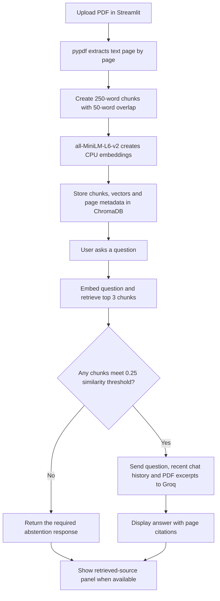

# Chat With Your PDF

A PDF question-answering application built for the **PromptForge GenAI & LLM Virtual Internship — Week 4 Final Project**. The app lets a user upload a text-based PDF, ask questions about its contents, and inspect the passages retrieved to support each answer.

The application brings together the main components developed during the first three weeks: Groq chat completions, sentence embeddings, semantic retrieval, and a grounded RAG prompt. Streamlit provides the upload and chat interface.

**Live application:** `https://chatplatform.streamlit.app/`

## Features

- Upload a PDF through a Streamlit file uploader.
- Extract text page by page with `pypdf`, retaining page numbers for source references.
- Split extracted text into overlapping chunks using the Week 3 configuration of 250 words and 50 words of overlap.
- Generate local CPU embeddings with `sentence-transformers/all-MiniLM-L6-v2`.
- Store chunk text, embeddings, and page metadata in a ChromaDB collection created for the current session and uploaded PDF.
- Retrieve up to three relevant passages for each question and apply the Week 3 minimum cosine-similarity threshold of `0.25`.
- Generate answers with the Groq API using retrieved PDF passages as the factual context.
- Retain the conversation in `st.session_state` and include recent turns for conversational continuity.
- Display page citations in answers and provide a collapsible source panel with retrieved excerpts, page numbers, and cosine-similarity scores.
- Show processing and response loading indicators, handle PDFs with no extractable text, and provide a **New Chat / Upload New PDF** reset action.

## Application workflow



### Retrieval and answer generation

1. **Extraction:** `pdf_utils.py` uses `pypdf` to extract selectable text from each PDF page. Page numbers are retained so chunks can be connected to their source pages.
2. **Chunking:** Text is combined in reading order and divided into 250-word chunks with a 50-word overlap. A chunk records every page represented in its text, including when it crosses a page boundary.
3. **Embedding and indexing:** `rag_utils.py` loads `sentence-transformers/all-MiniLM-L6-v2` on CPU. The embedding model is cached by Streamlit for reuse within the app process. Chunks, embeddings, and page metadata are added to a cosine-distance ChromaDB collection.
4. **Retrieval:** The question is embedded with the same model. ChromaDB returns up to three nearest chunks. The application converts cosine distance to cosine similarity and removes results below `0.25`.
5. **Generation:** The retrieved excerpts, current question, and a short window of recent conversation history are sent to Groq. The system prompt restricts factual answers to the retrieved excerpts, asks for PDF page citations, and requires the response `I don't know based on the provided context.` when the excerpts do not contain enough evidence.
6. **Source display:** The answer is shown in the chat. A **PDF sources** expander provides the retrieved text, page labels, and similarity scores for inspection.

The similarity threshold is a retrieval heuristic, not a confidence probability or a guarantee that a passage supports an answer. The retrieved evidence should be checked when accuracy matters.

## Technology stack

| Technology | Role in the application |
|---|---|
| Python 3.13 | Application logic and supporting modules |
| Streamlit | PDF upload, chat interface, session state, and web hosting |
| Groq Python SDK | Calls the chat-completions API for answer generation |
| `openai/gpt-oss-20b` | Default Groq-hosted generation model, configurable with `GROQ_MODEL` |
| Sentence Transformers | Generates document and question embeddings locally |
| `sentence-transformers/all-MiniLM-L6-v2` | 384-dimensional embedding model carried forward from Weeks 2 and 3 |
| ChromaDB | Stores and retrieves embedded PDF chunks |
| pypdf | Extracts text from PDF pages |
| NumPy | Numerical array support used with embedding operations |

### Main configuration

| Setting | Value |
|---|---:|
| Chunk size | 250 words |
| Chunk overlap | 50 words |
| Retrieval limit | Top 3 chunks |
| Minimum cosine similarity | 0.25 |
| Generation temperature | 0.2 |
| Embedding device | CPU |

These settings carry forward the chunking, embedding, retrieval, and generation choices recorded in the earlier PromptForge projects.

## Project structure

```text
chat-with-your-pdf/
├── app.py                         # Streamlit application entry point
├── pdf_utils.py                   # PDF extraction and page-aware chunking
├── rag_utils.py                   # Embeddings, ChromaDB, retrieval, and Groq generation
├── .streamlit/
│   └── secrets.toml.example       # Example secrets file; contains no real key
├── assets/
│   ├── screenshot.png             # Application screenshot (added separately)
│   └── demo.mp4                   # 1–2 minute walkthrough (added separately)
├── tests/
│   └── test_pdf_utils.py          # Unit tests for PDF chunking and page metadata
├── requirements.txt               # Python dependencies
├── final_reflection.md            # Reflection across all four weeks
├── .gitignore                     # Excludes secrets, virtual environments, and local data
└── README.md
```

## Configuration and API credentials

The Groq API key is read from Streamlit secrets. It is not stored in the Python source code.

For local development, copy `.streamlit/secrets.toml.example` to `.streamlit/secrets.toml` and add the credentials:

```toml
GROQ_API_KEY = "your_groq_api_key"
GROQ_MODEL = "openai/gpt-oss-20b"
```

The real `.streamlit/secrets.toml` file is excluded by `.gitignore`. 


## Local setup

The project was developed and tested locally with Python 3.13 on Windows.

Create and activate a virtual environment from the repository root:

```powershell
py -3.13 -m venv .venv
.\.venv\Scripts\Activate.ps1
```

Install the dependencies:

```powershell
python -m pip install --upgrade pip
python -m pip install -r requirements.txt
```

Create the local secrets file:

```powershell
Copy-Item .streamlit/secrets.toml.example .streamlit/secrets.toml
```

Add the Groq API key and model name to `.streamlit/secrets.toml`, then start the application:

```powershell
python -m streamlit run app.py
```

The first run downloads the embedding model and requires an internet connection. Embedding inference runs on CPU. Streamlit caches the model within the application process so it can be reused across sessions.

## Tests and local evaluation

Run the unit tests from the project root:

```powershell
python -m unittest discover -s tests -v
```

The four PDF utility tests cover:

- Default 250-word chunking and the 50-word overlap.
- Page metadata when a chunk contains text from more than one page.
- Empty input pages.
- Invalid chunk and overlap settings.

**Recorded local test result:** 4 tests passed.

### PDF chat test

The local chat was tested with `PromptForge_Week4_FinalProject.pdf`.

| Check | Observed result |
|---|---|
| Text-containing pages extracted | 3 |
| Chunks created | 5 |
| Question about the final project's objective | Answered with a reference to Page 1 |
| Question about the PDF processing workflow | Answered with references to the brief's processing steps |
| Question about chat-interface features and conversation history | Answered with the required interface and session-state details |
| Question about edge cases and deployment | Answered with the listed edge cases and deployment requirements |
| Unsupported question about the monthly intern stipend | Returned `I don't know based on the provided context.` |

This is a functional check using one short, text-based PDF, not a broad benchmark of retrieval quality. The test results do not establish performance on every document type or document size.

## Screenshots and demo

### Application screenshot


### Demo walkthrough

[Watch the Chat With Your PDF demo](assets/demo.mp4)

## Limitations

- The extractor reads selectable PDF text. Scanned or image-only PDFs are not processed with OCR; the app reports when no extractable text is found.
- ChromaDB uses an in-memory client. Collections are isolated by session and uploaded PDF, and are removed when the user resets the app or replaces the document. They do not provide persistent storage across an application-process restart.
- The embedding model runs on CPU. Its first download and embedding time depend on the hosting environment and PDF size.
- Retrieval is limited to the three highest-ranked passages that meet the heuristic similarity threshold. Relevant information may be missed if it is not present in those passages.
- Groq generation requires an API key and an internet connection. API availability and usage limits depend on the Groq account.
- The recorded evaluation covers one short PDF and five questions. Larger documents, multiple concurrent users, and a wider evaluation set require further testing.

## What I learned

The four-week project moved from a single LLM API call to a complete document-grounded application. The first week focused on message roles, conversation history, system prompts, and generation settings. The second week introduced vector embeddings and semantic search. The third week connected retrieval with answer generation and grounding. In the final week, those components became a Streamlit application with PDF upload, page-aware source references, conversation history, and a deployed-app workflow.

One important result from the work is that a high retrieval score alone does not prove that the retrieved passage contains the answer. The source passages and page references make the evidence visible, while the abstention response provides a clear outcome when the available context does not support an answer. The implementation and experiments are described in more detail in [`final_reflection.md`](final_reflection.md).